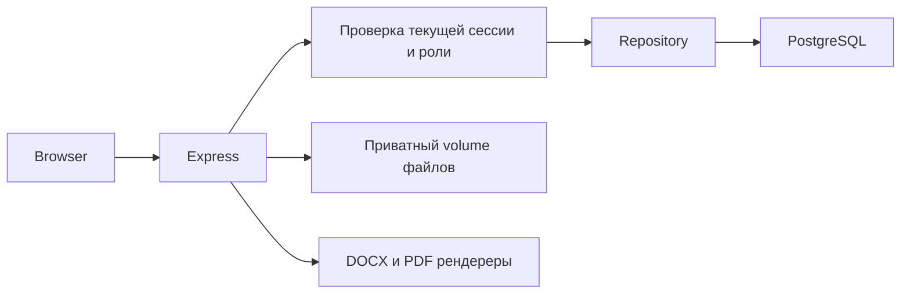

# Архитектура локального среза

React SPA и Express работают на одном origin. В dev Express подключает Vite middleware; Docker собирает статический `dist` и обслуживает его через Express. API расположен в `server/app.ts`, слой хранения — `server/repositories/repository.ts`. `DemoRepository` используется только без `DATABASE_URL`; `PostgresRepository` хранит состояние в PostgreSQL. Если заданная БД недоступна, сервер отказывается запускаться, не подменяя её памятью.

Файл сначала записывается в приватный volume, затем транзакция фиксирует версию, квитанцию и аудит сдачи. При известной ошибке транзакции файл удаляется. Скачивание проходит через проверку роли и конкретного задания. Администратор не получает содержимое работ. PDF конструктора хранится как байты, связанные с хешем квитанции. У старых синтетических записей импорта байтов нет, поэтому скачивание отвечает 404.

Миграции из `db/migrations/` применяются при старте приложения и отмечаются в `schema_migrations`. Синтетический seed запускается только вручную с `ALLOW_SYNTHETIC_SEED=true`. `docker compose down` сохраняет оба volume. Резервное копирование и восстановление проверены в отдельном проекте Compose; процедура описана в `docs/operations.md`.

Сессия хранится на сервере как хеш токена. Браузер получает токен в HttpOnly SameSite=Strict cookie; при HTTPS cookie имеет атрибут Secure. Изменяющие запросы требуют CSRF-токен из ответа входа или `/api/auth/me`. В продукционном режиме bearer-токен не возвращается.
