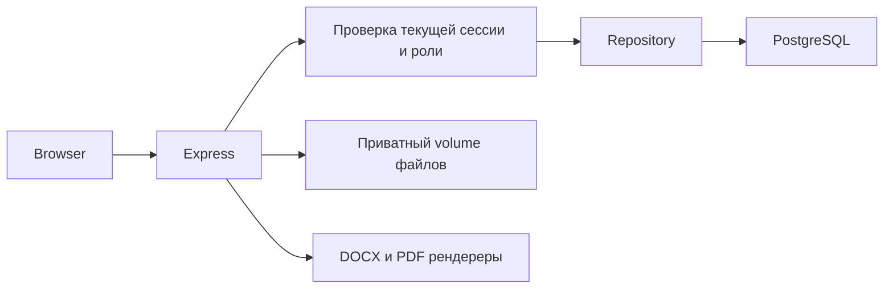

# Архитектура локального среза

React SPA и Express работают на одном origin. В dev Express подключает Vite middleware; Docker собирает статический `dist` и обслуживает его через Express. API расположен в `server/app.ts`, слой хранения — `server/repositories/repository.ts`. `DemoRepository` используется только без `DATABASE_URL`; `PostgresRepository` хранит состояние в PostgreSQL. Если заданная БД недоступна, сервер отказывается запускаться, не подменяя её памятью.

Файл сначала записывается в приватный volume, затем транзакция фиксирует версию, квитанцию и аудит сдачи. При известной ошибке транзакции файл удаляется. Скачивание проходит через проверку роли и конкретного задания. Администратор не получает содержимое работ. PDF конструктора хранится как байты, связанные с хешем квитанции. У старых синтетических записей импорта байтов нет, поэтому скачивание отвечает 404.

Миграция `db/migrations/001_init.sql` применяется на пустом Docker volume при старте PostgreSQL. Seed запускается вручную и идемпотентен. `docker compose down` сохраняет оба volume. Процедура резервного копирования и восстановления ещё не проверена; перед пилотом требуется отдельная репетиция на копии.

Текущая сессия — серверная запись с хешем bearer token, передаваемого в JSON и хранимого клиентом в памяти. Это ограничение локального среза; целевой контракт — HttpOnly Secure cookie и CSRF-защита.
